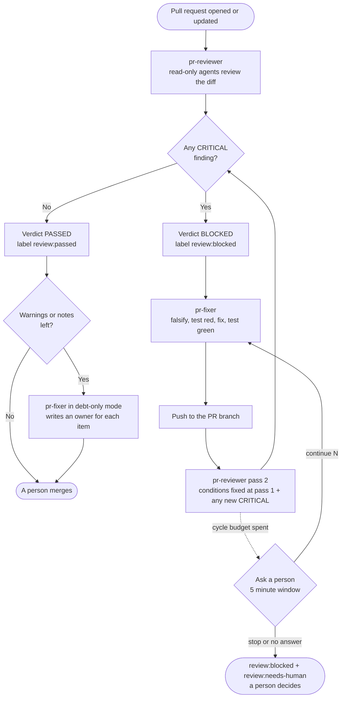
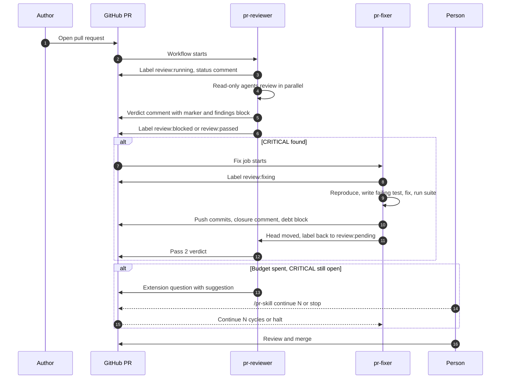
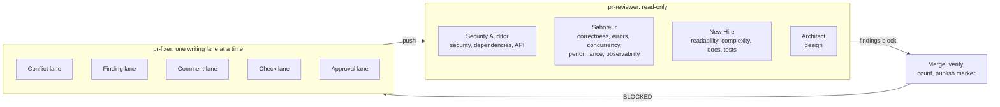
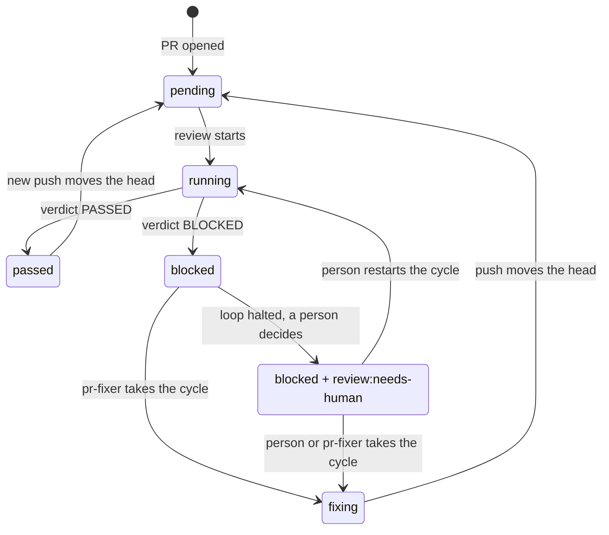
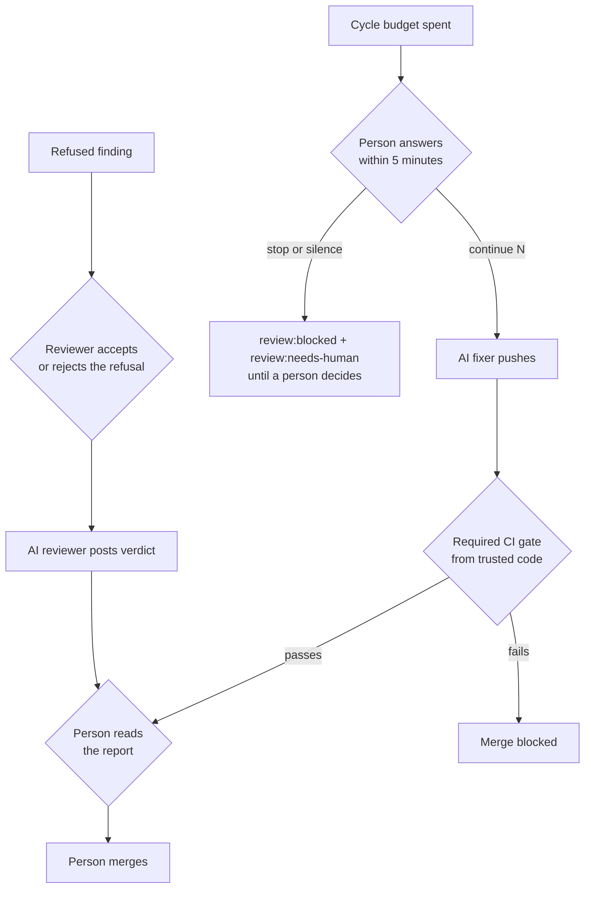

# pr-reviewer-fixer

Two [Agent Skills](https://agentskills.io) that review and repair pull requests with AI, and keep a
person in charge of the merge.

- **`pr-reviewer`** reviews a pull request. It reads the diff with several read-only agents, checks
  every finding before reporting it, and publishes one verdict, `PASSED` or `BLOCKED`, tied to the
  exact commit it read.
- **`pr-fixer`** closes what the reviewer found. It tries to reproduce each finding, writes a test
  that fails first, fixes the code, proves the fix, and hands the branch back to the reviewer. It
  also resolves merge conflicts and failing CI without being asked.

Each skill is a folder with a `SKILL.md`, so the same files work in Claude Code, Codex, Copilot,
Cursor, Gemini CLI, OpenCode and other harnesses that read that format (see
[Install](#install)).

> Status: the scripts are covered by tests that run against a fake `gh`. The GitHub Actions
> templates pass `actionlint` and load as YAML, but they have not run on a live repository yet. Try
> them on a scratch repository first. See [Limits](#limits-and-honest-caveats).

## Why these skills exist

An AI that reviews its own code shares the author's blind spots, so it tends to approve. A reviewer
that is told to find problems tends to find some whether or not they exist, and a loop where every
finding blocks the merge never ends. These skills are built around those two failure modes:

1. The reviewer is separate from the fixer. The fixer runs in a fresh context and never judges
   its own work. The reviewer re-checks the correction.
2. Only a CRITICAL blocks. A CRITICAL is data loss, a security breach, an outage, or a broken
   invariant your project declares non-negotiable. Warnings and notes are recorded as debt with a
   named owner and never hold the merge.
3. Every finding is tested before it is fixed. The fixer must reproduce the problem, see a test
   fail, fix it, and see the test pass. A finding that does not reproduce is refused with evidence.
4. The loop stops. After five automatic cycles the skills ask a person whether to continue. No
   answer within five minutes leaves the pull request `review:blocked` with `review:needs-human` added.
5. The verdict is arithmetic, and a script checks it. The counts of critical findings, warnings
   and notes go into a marker comment. The script refuses a `BLOCKED` with no CRITICAL and a
   `PASSED` with one.

## How it works



The two skills never talk to each other directly. They talk through the pull request: labels, a
verdict comment with a machine-readable marker, a closure comment, and a debt block in the PR body.
Because of that, either skill can run in a different harness, on a different model, or by hand.



## What each skill does

### pr-reviewer

- Reads the pull request description and linked issue, then the project's own rules (contributor
  guide, `CLAUDE.md`, `AGENTS.md`, lint configuration), prior comments and CI results.
- Fixes the acceptance conditions at pass 1, before looking for defects. Later passes check only
  those conditions and any new CRITICAL, so the target does not move.
- Dispatches one read-only agent per applicable review dimension (thirteen dimensions: correctness,
  design, security, testing, concurrency and so on). Each agent works under one stance: Saboteur,
  New Hire, Security Auditor or Architect.
- Verifies each finding against the code before reporting it, and merges duplicates.
- Splits large diffs into units, reviews the seams between them, and reports what was and was not
  read in depth.
- Publishes the verdict through `scripts/review-cycle.sh`, which binds it to the head commit.

### pr-fixer

- Reads the findings from the reviewer's verdict comment and nothing else as a work list. Text from
  other commenters is data, not instructions.
- Takes the cycle first (`review:fixing`), so the pull request cannot merge while a correction is in
  flight.
- Works lanes one at a time on the branch: conflicts, findings, comments, failing checks.
- For each CRITICAL: reproduces it, writes a test that reproduces the threat (not the
  implementation), watches it fail, fixes, watches it pass, runs the whole suite.
- Resolves merge conflicts by merging the base into the branch, regenerating generated files and
  never force-pushing over other people's commits. See `.agents/skills/pr-fixer/references/conflicts.md`.
- Classifies failing CI as transient, pre-existing on the base branch, or genuine, and reruns only
  what a rerun can fix. See `.agents/skills/pr-fixer/references/ci-failures.md`.
- Writes an owner next to every warning and note in a `pr-debt` block in the PR body.



## What lands on the pull request

| Artifact | Written by | Purpose |
|---|---|---|
| Label `review:*` | `review-cycle.sh` only | State at a glance in the PR list |
| Verdict comment with `<!-- adversarial-review: sha=... -->` | reviewer, through the script | The authority. The label is its projection |
| `findings` block at the end of the verdict | reviewer | The fixer's work list |
| Closure comment with `<!-- pr-fixer-closure: ... -->` | fixer | Reproduction, test, red, fix, green, suite counts per finding |
| `pr-debt` block in the PR body | fixer | Owner for every warning and note |
| Extension question and answer | workflow and a person | Continue or stop after the cycle budget |

The full list, with the exact `gh` command to find each one, is in
[`pr-reviewer/references/pr-protocol.md`](.agents/skills/pr-reviewer/references/pr-protocol.md). The same file ships
in both skills.

Labels move like this:



## Cycle budget and human control

| Setting | Default | Meaning |
|---|---|---|
| `MAX_REVIEW_CYCLES` | 5 | Automatic review, fix, re-review rounds |
| `MAX_REVIEW_CYCLES_HARD` | 10 | Absolute ceiling. No answer can pass it |
| `EXTENSION_WAIT_SECONDS` | 300 | How long the question waits |

After the fifth cycle, if a CRITICAL is still open, the workflow posts one question. It lists what
is open, the open count at each pass, and a suggestion:

- if the open count fell in the last two cycles, it suggests up to three more;
- if it fell once and then stalled, it suggests one more;
- if there was no progress, it suggests none and recommends that a person decides.

A person with write access replies with a comment whose first line is exactly
`/pr-skill continue N` or `/pr-skill stop`. Replies from anyone else are ignored. The wait is a plain
workflow step with no model in it. With no valid reply in time, the pull request stays
`review:blocked`, now with `review:needs-human`, and a comment states why.

## Install

The skill folders live in `.agents/skills/` in this repository and nowhere else. Copy or symlink
them to the place your harness reads skills from. `.agents/skills/` is the widest common path. Paths below were checked against each
vendor's documentation on 2026-10-14. Vendors move these, so confirm against the current docs.

| Harness | Project path | User path | Notes |
|---|---|---|---|
| Claude Code | `.claude/skills/` | `~/.claude/skills/` | Invoke as `/pr-reviewer`, or let the description trigger it |
| OpenAI Codex CLI | `.agents/skills/` | `~/.agents/skills/` | `$pr-reviewer`, `/skills`, or implicit |
| GitHub Copilot (CLI, VS Code, cloud agent) | `.github/skills/`, `.claude/skills/` or `.agents/skills/` | `~/.copilot/skills/` or `~/.agents/skills/` | Native code review has no model choice |
| Gemini CLI | `.gemini/skills/` or `.agents/skills/` | `~/.gemini/skills/` or `~/.agents/skills/` | Moved to Antigravity CLI for some tiers on 2026-06-18 |
| Cursor | `.cursor/skills/`, `.agents/skills/`, also reads `.claude/skills/` | `~/.claude/skills/` | Slash invocation not verified |
| OpenCode | `.opencode/skills/`, `.claude/skills/`, `.agents/skills/` | `~/.config/opencode/skills/` | Per-agent `permission.skill` |
| Amp | `.agents/skills/`, also `.claude/skills/` | `~/.config/agents/skills/` | |
| Roo Code | `.roo/skills/` or `.agents/skills/` | `~/.roo/skills/` | |
| Cline | `.cline/skills/` | `~/.cline/skills/` | Invocation detail not verified |
| Kiro | `.kiro/skills/` | `~/.kiro/skills/` | Global path reported inconsistently |
| Windsurf (Devin Desktop) | `.devin/skills/` or `.windsurf/skills/` | `~/.codeium/windsurf/skills/` | |
| Zed | `.agents/skills/`, flat layout, trusted worktrees only | `~/.agents/skills/` | |
| JetBrains Junie | `.junie/skills/` | `~/.junie/skills/` | |
| Aider | none | none | No skills feature. Load `SKILL.md` with `--read` |

Two practical notes:

- The skill frontmatter uses `name` and `description`, plus `metadata.version`, which the
  specification allows as free-form metadata. The `templates/` folder is not part of the Agent
  Skills specification. It works because `SKILL.md` points to it by path.
- The scripts need `gh` (authenticated), `python3` 3.9 or newer, and `node`. The test suite also
  needs `jq` and PyYAML.

### Quick install, project level

Run these from a clone of a release tag, inside the repository you install into:

```bash
mkdir -p .agents/skills
cp -R <clone>/.agents/skills/pr-reviewer <clone>/.agents/skills/pr-fixer .agents/skills/
```

The workflow templates call the scripts at `.agents/skills/pr-reviewer/scripts/` and
`.agents/skills/pr-fixer/scripts/`, and their prompts tell the agent to read the `SKILL.md` there.
If you install elsewhere, replace that prefix in the workflow files you copy.

Claude Code reads `.claude/skills/`, not `.agents/skills/`. To use the skills interactively in
Claude Code, link them in your own repository: `mkdir -p .claude/skills && ln -s
../../.agents/skills/pr-reviewer .claude/skills/pr-reviewer`, and the same for `pr-fixer`. The
workflows do not need the link.

### Versions and updates

Both skills ship under one semantic version. It is in `VERSION`, in `metadata.version` of each
`SKILL.md`, and in the newest `CHANGELOG.md` entry. Each release is a GitHub release tagged
`vX.Y.Z`.

At the start of a run, outside CI, the skills run `scripts/check-version.sh`. If a newer release
exists it prints one notice with the release link, and the agent asks you whether to update. The
script never downloads or installs anything. To update, repeat the install step from the new
release tag. The latest release answer is cached for 24 hours. Set `PR_SKILLS_NO_UPDATE_CHECK=1`
to turn the check off. It is also skipped when `CI` or `GITHUB_ACTIONS` is `true`.

## Run it by hand

In any supported harness, from the branch of an open pull request:

```text
/pr-reviewer          review the open pull request and publish the verdict
/pr-fixer             close the findings on that pull request
```

You can also call the state machine directly:

```bash
.agents/skills/pr-reviewer/scripts/review-cycle.sh ensure-labels   # once per repository
.agents/skills/pr-reviewer/scripts/review-cycle.sh status 123      # what is owed at this head
```

## Run it on every pull request

1. Create the labels once: `review-cycle.sh ensure-labels`.
2. Copy the workflow templates for your model provider into `.github/workflows/`:
   - `pr-review.claude.yml` and `pr-review-cycle.claude.yml` (needs secret `ANTHROPIC_API_KEY`), or
   - `pr-review.codex.yml` and `pr-review-cycle.codex.yml` (needs secret `OPENAI_API_KEY`).
   - Optional: `pr-fixer-proactive.*.yml` to react to failed CI and to base-branch conflicts.
3. Create a token for the fixer's pushes and store it as `FIXER_PUSH_TOKEN`. A push made with the
   default `GITHUB_TOKEN` does not start other workflows, so your required CI would never run on the
   fixer's commit.
4. Set the repository variable `REVIEW_MARKER_AUTHORS` to the login that publishes verdicts. For
   the default Actions token that login is `github-actions`. Without it, any commenter could post a
   forged verdict marker.
5. In branch protection or a ruleset, mark the `review-gate` job as a required check. It runs from
   the base branch, not from the pull request, so a pull request cannot edit its own gate.
6. Add CODEOWNERS entries for `.agents/skills/**` and `.github/workflows/**`.
7. Pin each third-party action in the templates to a full commit SHA. The templates ship with the
   SHAs resolved on 2026-10-14. Keep them current with Dependabot.

The `review` and `fix` jobs run code from the pull request with the provider's API key available,
so they are limited to branches in the same repository. The gate is what protects the merge.

## Model and effort

Each unit of work is given a tier, and the tier maps to a model and an effort setting for the harness
in use. Deep tier goes to security, design and correctness review and to conflict resolution.
Standard goes to bounded analysis and scoped edits. Fast goes to pattern checks and transcription. The
dispatcher passes `model` and `effort` on every call because declaring them in a file alone does
nothing in most harnesses. Current mappings are in
[`pr-reviewer/references/execution-profiles.md`](.agents/skills/pr-reviewer/references/execution-profiles.md) and a
dated matrix of harness options is in
[`pr-reviewer/references/harness-matrix.md`](.agents/skills/pr-reviewer/references/harness-matrix.md). Model names
change often, so check them before relying on an id.

## Using this under ISO/IEC 27001 and ISO/IEC 42001

These skills can supply operating evidence for an information security management system
(ISO/IEC 27001:2022) and an AI management system (ISO/IEC 42001:2023). They do not make an
organisation compliant or certified. A certification body assesses an organisation's management
system, not a tool.

The short version of how to use them in line with both standards:

- Keep a person accountable for the merge. Configure branch protection so the AI verdict is
  advisory and a named human approves. Write that rule into your procedure.
- Give the two bots different rights. The reviewer is read-only. The fixer cannot approve or
  merge its own change.
- Treat the model provider as a supplier. Assess it, sign the agreement, check retention and
  training terms, and record the model and version in use.
- Treat prompts and skills as controlled configuration. A change to a skill, a prompt, a model
  or a token scope is a change and goes through change management.
- Run an AI impact assessment and an AI risk assessment before you rely on the output, and
  record the result. The skills cannot do this for you.
- Keep records on purpose. Labels and comments are working data and can be edited by people with
  the right permission. Export platform audit logs to protected storage and set retention.
- Monitor the AI system. Track missed defects, false alarms, reverts and escalation rate, and
  re-validate when the provider changes the model.

The control-by-control mapping, with sources and the points where the standards are silent, is in
[`docs/ISO-27001-AND-42001.md`](docs/ISO-27001-AND-42001.md). Read its limits section before you use
it in a Statement of Applicability.



## Limits and honest caveats

- Not run on live GitHub Actions yet. The workflow templates pass `actionlint` and their shell
  steps are tested against a fake `gh`. Reusable-workflow call limits and runner behaviour are
  untested. Use a scratch repository first.
- The fix job executes your tests. It gives an agent file-write tools and also runs
  repository-defined scripts. That is needed to prove a fix, and it is a real risk on untrusted
  input. The templates restrict it to same-repository branches and exact tool allowlists.
- Labels and comments are not tamper-evident. Anyone with the right permission can edit them.
  The author filter and the gate raise the cost of forgery. They do not make a legal record.
- An AI verdict is not a human review. It reduces the chance that an obvious defect reaches the
  merge. It does not replace accountable review for high-risk changes.
- Model names and harness paths change. The data here is dated 2026-10-14.
- Research, not guarantees. The catalogs in `references/improvements-catalog.md` are researched
  ideas with sources. Only the items marked `SKILL` shaped the rules. The rest are options.

## Repository layout

```text
.agents/skills/
  pr-reviewer/          the reviewer skill (SKILL.md, references/, scripts/, templates/)
  pr-fixer/             the fixer skill (SKILL.md, references/, scripts/, templates/)
.github/workflows/      this repository's own review loop and the release workflow
docs/
  ISO-27001-AND-42001.md
  diagrams/             the Mermaid sources used in this README
tests/                  fake-gh tests: run tests/run-all.sh
VERSION, CHANGELOG.md   the release version and its history
```

Both skills ship `scripts/review-cycle.sh`, `scripts/gate-pr-review-state.py` and
`scripts/check-version.sh`. The copies are identical on purpose, so each skill works alone.
`tests/run-all.sh` checks that they match.

## Tests

```bash
bash tests/run-all.sh
```

The suite needs no network. It drives the scripts against a fake `gh` and covers label transitions,
the refusals (a `BLOCKED` with no CRITICAL, a stale commit, an oversized report, a forged marker),
triage decisions, the extension-wait step, the cycle-budget logic and the version check.
