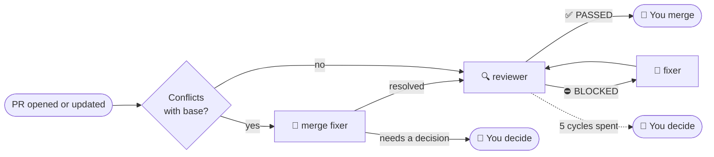

# pr-reviewer-fixer

**Three Agent Skills that review pull requests, fix the findings and resolve merge conflicts with AI. They never merge: a person makes the final call.**

| Skill | What it does | Writes to the pull request |
|---|---|---|
| 🔍 **pr-reviewer** | Reads the diff with several read-only agents and gives one verdict: `PASSED` or `BLOCKED`. | A verdict report, with a summary table and a machine-readable block |
| 🔧 **pr-fixer** | Takes the reviewer's findings, reproduces each one, writes a test that fails first, fixes it and proves the fix. | A closure comment with a checkpoint list, one line per finding |
| 🔀 **pr-merge-fixer** | Resolves merge conflicts with the base branch before the review, and again when the base moves. | A merge closure comment with a table of files and how each one was resolved |

🧭 **New here?** Start with the [quick start](docs/QUICKSTART.md). Want the full picture? Read the [guide](docs/HOW-IT-WORKS.md). Looking for a fact? Use the [reference](docs/SKILLS-REFERENCE.md).

🌐 Project site: <https://jonyfs.github.io/pr-reviewer-fixer/>

---

## Why three skills

An AI that reviews its own code tends to approve it. An AI told to find problems tends to invent some. So the work is split:

1. **The reviewer does not fix.** It only reads and reports.
2. **The fixer does not judge its own fix.** A fresh reviewer checks it again.
3. **Only a critical problem blocks the merge** by default. Warnings and notes become debt with a named owner.
4. **Conflicts are not a person's chore.** The merge fixer resolves the ones the code can decide, and stops on the rest.
5. **The loop has a limit.** After five automatic cycles, the agent asks you. It never keeps going on its own.

## How a pull request moves



The three skills never call each other. They talk through the pull request: labels, comments with a marker, and one block in the PR body. Every comment says who wrote it, so you always know which agent acted and what it checked.

## Quick start

You need `gh` signed in, `python3` 3.9+ and `node`.

```bash
# 1. From a release clone, see what would be installed (changes nothing)
./install.sh --harness claude-code

# 2. Install all three skills
./install.sh --harness claude-code --yes

# 3. In the repository you want reviewed
export REVIEW_MARKER_AUTHORS="$(gh api user --jq .login)"
.claude/skills/pr-reviewer/scripts/review-cycle.sh ensure-labels
```

Other harnesses (Codex, Copilot, Gemini CLI, Cursor, OpenCode and more) work the same way with a different `--harness` value. The full table is in the [reference](docs/SKILLS-REFERENCE.md#install).

## What you will see on a pull request

| Comment | Starts with | Written by |
|---|---|---|
| Verdict report | `🤖 Written by pr-reviewer` | the reviewer, after its checks |
| Closure report | `🔧 Written by pr-fixer` | the fixer, after it ran |
| Merge report | `🔀 Written by pr-merge-fixer` | the merge fixer, after it pushed |

Labels show the state at a glance: `review:pending`, `review:running`, `review:passed`, `review:blocked`, `review:fixing`, `review:needs-human`. A person never sets them by hand.

## Read next

- 🚀 [Quick start](docs/QUICKSTART.md): install, first pull request, what to expect
- 🧠 [How it works](docs/HOW-IT-WORKS.md): each step, and why each rule exists
- 📘 [Skills reference](docs/SKILLS-REFERENCE.md): commands, labels, markers, environment variables
- 🙋 [FAQ](docs/FAQ.md): the questions people ask most
- 🛠️ [Full reference](docs/REFERENCE.md): the complete previous README, with install details, limits and the security model
- 🧾 [Changelog](CHANGELOG.md) and [design notes](docs/designs/communication-0.20.0.md)

## Limits

- The review and the fix run as agents in your own session. No GitHub Actions workflow calls a model, and no provider key is used.
- The automatic reviewer never approves or requests changes on GitHub. Its verdict is a comment and a label.
- Nothing is merged, approved, tagged or released by these skills. You do that.
- Read [Limits and honest caveats](docs/REFERENCE.md#limits-and-honest-caveats) before you rely on this in a repository you care about.

## Version

The current release is in [`VERSION`](VERSION). New releases are listed in the [changelog](CHANGELOG.md).
