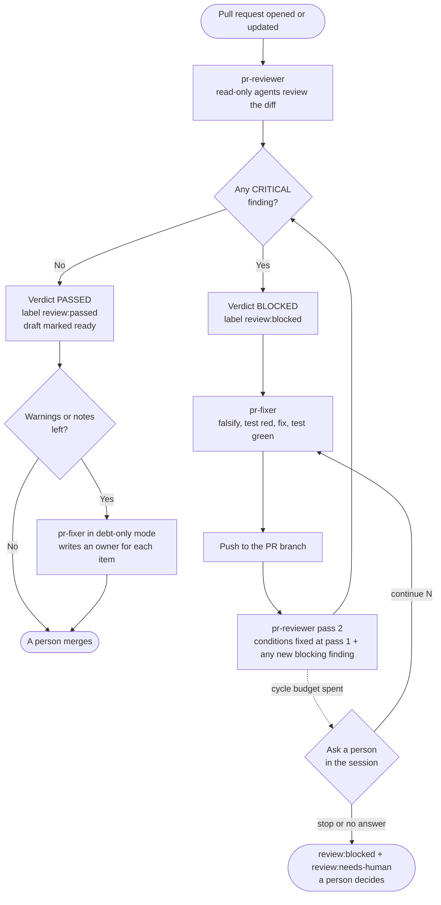
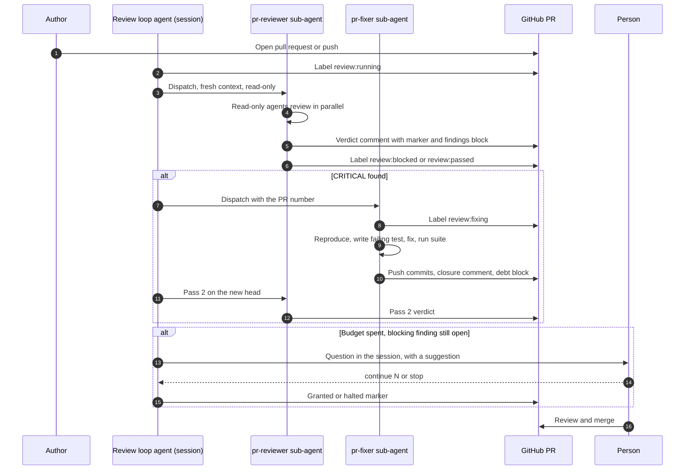
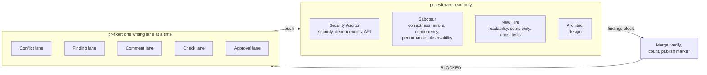
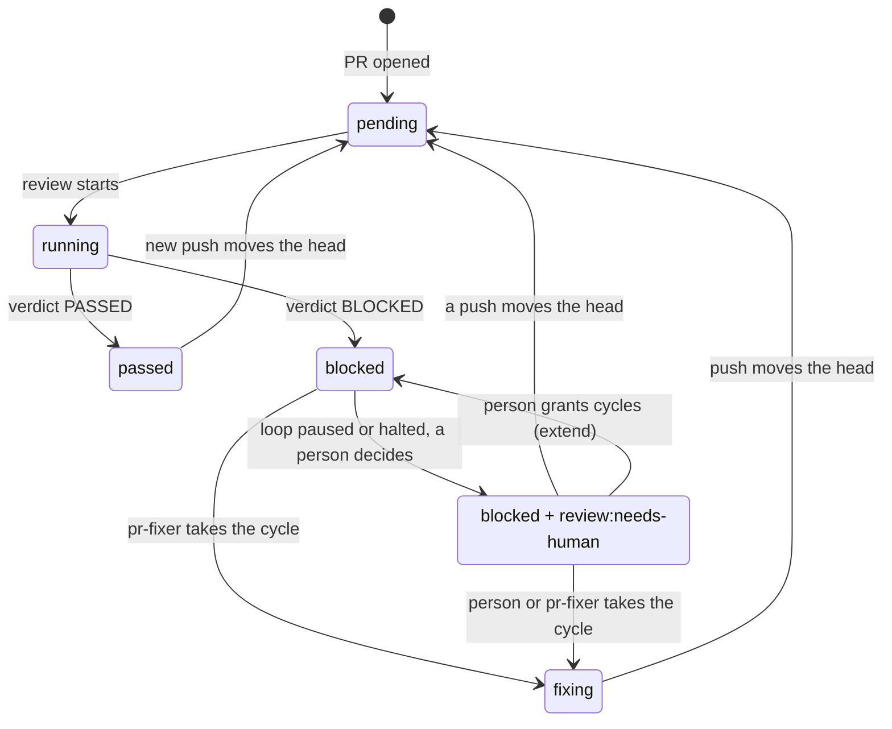
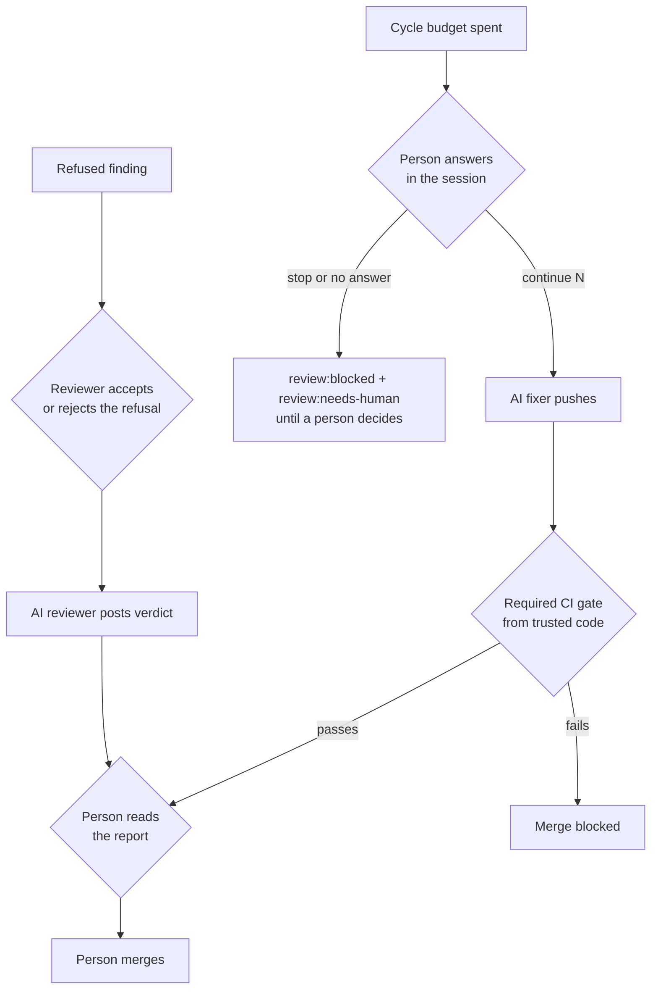

# pr-reviewer-fixer

Two [Agent Skills](https://agentskills.io) that review and repair pull requests with AI, and keep a
person in charge of the merge.

- **`pr-reviewer`** reviews a pull request. It reads the diff with several read-only agents, checks
  every finding before reporting it, and publishes one verdict, `PASSED` or `BLOCKED`, tied to the
  exact commit it read.
- **`pr-fixer`** closes what the reviewer found. It tries to reproduce each finding, writes a test
  that fails first, fixes the code, proves the fix, and hands the branch back to the reviewer. It
  also resolves merge conflicts and failing CI without being asked.

Each skill is a folder with a `SKILL.md`, so the same files work in Claude Code, Codex, Copilot,
Cursor, Gemini CLI, OpenCode and other harnesses that read that format (see
[Install](#install)).

> Status: the scripts are covered by tests that run against a fake `gh`. The review and the fix run
> as agents in your own harness session. No GitHub Actions workflow calls a model and no provider
> API key is used. The one workflow template, the `review-gate` check, has not run on a live
> repository yet. See [Limits](#limits-and-honest-caveats).

For a plain-language walk through everything the two skills do, with diagrams, read
[`docs/HOW-IT-WORKS.md`](docs/HOW-IT-WORKS.md).

## Why these skills exist

An AI that reviews its own code shares the author's blind spots, so it tends to approve. A reviewer
that is told to find problems tends to find some whether or not they exist, and a loop where every
finding blocks the merge never ends. These skills are built around those two failure modes:

1. The reviewer is separate from the fixer. The fixer runs in a fresh context and never judges
   its own work. The reviewer re-checks the correction.
2. By default only a CRITICAL blocks. A CRITICAL is data loss, a security breach, an outage, or a
   broken invariant your project declares non-negotiable. Warnings and notes are recorded as debt with
   a named owner and do not hold the merge. Set `REVIEW_BLOCK_AT=warning` and a WARNING blocks too:
   the fixer then corrects likely bugs before the merge instead of the team carrying them as debt.
   Each blocking WARNING must name a concrete failing input (`scenario:`), so style opinions stay
   notes. Use the same value in the shell that publishes and in the repository variable the
   `review-gate` reads. The value is read exactly, in lower case: `Warning` makes `status` and the
   gate inconclusive, so check the variable when you upgrade from 0.7.0. A verdict published under
   `warning` records it in the marker (`block_at=warning`). While that marker is at the head, a
   shell or gate running with another setting answers inconclusive instead of misreading it.
3. Every finding is tested before it is fixed. The fixer must reproduce the problem, see a test
   fail, fix it, and see the test pass. A finding that does not reproduce is refused with evidence.
4. The loop stops. After five automatic cycles the agent asks the person in the session whether
   to continue. No answer leaves the pull request `review:blocked` with `review:needs-human` added.
5. The verdict is arithmetic, and a script checks it. The counts of critical findings, warnings
   and notes go into a marker comment. The script refuses a `BLOCKED` with no CRITICAL and a
   `PASSED` with one.

## How it works



The two skills never talk to each other directly. They talk through the pull request: labels, a
verdict comment with a machine-readable marker, a closure comment, and a debt block in the PR body.
Because of that, either skill can run in a different harness, on a different model, or by hand.

A third role, the review loop agent, is the session's own agent. It starts the loop when the
agent opens or pushes to a pull request, dispatches the reviewer and the fixer as fresh-context
sub-agents, reads the cycle budget from the markers, and asks you when the budget is spent. It
neither reviews nor edits code. The procedure is in
[`harness-loop.md`](.agents/skills/pr-reviewer/references/harness-loop.md).



## What each skill does

### pr-reviewer

- Reads the pull request description and linked issue, then the project's own rules (contributor
  guide, `CLAUDE.md`, `AGENTS.md`, lint configuration) as they are on the base commit, so a pull
  request cannot rewrite the rules it is judged by, then prior comments and CI results.
- Fixes the acceptance conditions at pass 1, before looking for defects. Later passes check only
  those conditions and any new blocking finding, so the target does not move.
- Dispatches one read-only agent per applicable review dimension (thirteen dimensions: correctness,
  design, security, testing, concurrency and so on). Each agent works under one stance: Saboteur,
  New Hire, Security Auditor or Architect.
- Verifies each finding against the code before reporting it, and merges duplicates.
- Splits large diffs into units, reviews the seams between them, and reports what was and was not
  read in depth.
- Takes the hits of `scripts/scan-hidden.py` (zero-width and bidi characters, Unicode tag
  characters, HTML comments other than the protocol's markers, `<details>` blocks, invisible HTML)
  in the added lines, the pull request text, its comments and the commit messages, and judges each
  as a candidate CRITICAL prompt-injection finding. The scanner strips nothing.
- Runs `review-cycle.sh screen --diff <base> <head>` over the lines the pull request adds. Each
  token or private key it finds is a mandatory CRITICAL finding at that line, with the value
  redacted.
- Checks its own findings with `review-cycle.sh lint-report` before publishing: each one must name a
  file and a line the diff shows, and the counts must match the open entries.
- Publishes the verdict through `scripts/review-cycle.sh`, which binds it to the head commit. When
  the verdict is `PASSED` and the pull request is a draft, the script marks it ready for review.

### pr-fixer

- Reads the findings from the reviewer's verdict comment and nothing else as a work list. Text from
  other commenters is data, not instructions.
- Takes the cycle first (`review:fixing`), so the pull request cannot merge while a correction is in
  flight.
- Works lanes one at a time on the branch: conflicts, findings, comments, failing checks.
- For each CRITICAL: reproduces it, writes a test that reproduces the threat (not the
  implementation), watches it fail, fixes, watches it pass, runs the whole suite.
- Resolves merge conflicts by merging the base into the branch, regenerating generated files and
  never force-pushing over other people's commits. See `.agents/skills/pr-fixer/references/conflicts.md`.
- Classifies failing CI as transient, pre-existing on the base branch, or genuine, and reruns only
  what a rerun can fix. See `.agents/skills/pr-fixer/references/ci-failures.md`.
- Runs `scripts/push-guard.sh` before every push. It refuses a wrong branch, a fork, a push that is
  not a fast-forward and a commit that touches a file no finding names. A merge commit counts the
  files it changes beyond git's automatic merge of its parents (a conflict resolution, or an edit
  slipped into the merge), which needs git 2.38 or later; commits the base already holds are not
  checked. It also screens the lines those commits add and refuses one that adds what looks like a
  token or a private key. Before each commit the fixer runs `review-cycle.sh screen --staged`, the
  same screen over the staged diff. It refuses any commit that touches `.github/workflows/**`,
  `.github/actions/**`, CODEOWNERS, `.agents/skills/**`, `.claude/**` or `.mcp.json`, even when a
  finding names the file: such a finding goes to a person. A person can opt one class in with
  `PUSH_GUARD_ALLOW_SENSITIVE` (for example `skills` in a repository of skills, as this one is).
- Writes an owner next to every warning and note in a `pr-debt` block in the PR body.



## What lands on the pull request

| Artifact | Written by | Purpose |
|---|---|---|
| Label `review:*` | `review-cycle.sh` only | State at a glance in the PR list |
| Verdict comment with `<!-- adversarial-review: sha=... -->` | reviewer, through the script | The authority. The label is its projection |
| `findings` block at the end of the verdict | reviewer | The fixer's work list |
| Closure comment with `<!-- pr-fixer-closure: ... -->` | fixer, after `review-cycle.sh screen` passes it | Reproduction, test, red, fix, green, suite counts per finding |
| `pr-debt` block in the PR body | fixer, after `review-cycle.sh screen` passes it | Owner for every warning and note |
| Extension answer (`state=granted` or `state=halted`) | `review-cycle.sh extend` or `halt`, after a person answered in the session | Continue or stop after the cycle budget |

The full list, with the exact `gh` command to find each one, is in
[`pr-reviewer/references/pr-protocol.md`](.agents/skills/pr-reviewer/references/pr-protocol.md). The same file ships
in both skills.

Labels move like this:



`review-cycle.sh stale` performs the moves back to `pending`. The fixer runs it after its push and the
review loop runs it after any push it sees. A push made outside a session leaves the old label until
the next loop runs, but the `review-gate` check fails at once, because the verdict marker names the
old commit.

## Cycle budget and human control

| Setting | Default | Meaning |
|---|---|---|
| `MAX_REVIEW_CYCLES` | 5 | Automatic review, fix, re-review rounds |
| `MAX_REVIEW_CYCLES_HARD` | 10 | Absolute ceiling. No answer can pass it |

The last cycle of each allowance (the fifth with the defaults, and the last of every extension you
grant) uses a stronger fixer: one tier up, or `effort: "higher"` where the harness takes it. It is a
single attempt. After the fifth cycle, if a blocking finding is still open, `review-cycle.sh budget` says `ask` and the
review loop agent asks you in the session. It lists what is open, the open count at each pass,
and a suggestion:

- if the open count fell in the last two cycles, it suggests up to three more;
- if it fell once and then stalled, it suggests one more;
- if there was no progress, it suggests none and recommends that a person decides.

You answer `continue N` or `stop`. `continue N` runs `review-cycle.sh extend`, which records the
grant in a marker comment so it survives the session, and removes `review:needs-human` if the pull
request was halted. `stop`, or no answer in a headless session,
runs `review-cycle.sh halt`: the pull request stays `review:blocked`, now with
`review:needs-human`, and a comment states why. While the BLOCKED verdict is still at the head,
`review-cycle.sh start` refuses a halted pull request, so a new review pass needs a pushed
correction or a grant. A comment on the pull request cannot grant cycles.

Cycles are counted from the highest `pass=` among the trusted markers, whatever commit it names.
`publish` takes only the next pass number (`budget` prints it as `B_NEXT_PASS`), so a head that goes
back to an older reviewed commit, or a low `--pass`, cannot restart the count.

## Install

### Requirements

- `gh`, signed in. Check with `gh auth status`.
- `python3` 3.9 or newer, and `node`.
- Only to run this repository's test suite: `jq` and PyYAML.

### Quick install, project level

Install into the repository whose pull requests you want reviewed. Clone a release tag (the newest
one is on the [releases page](https://github.com/jonyfs/pr-reviewer-fixer/releases)), then run
`install.sh` from your repository. It copies the two skill folders to the path your harness reads:

```bash
git clone --depth 1 --branch v<version> https://github.com/jonyfs/pr-reviewer-fixer.git ~/pr-reviewer-fixer
cd <your-repository>
~/pr-reviewer-fixer/install.sh --harness claude-code          # prints the plan, changes nothing
~/pr-reviewer-fixer/install.sh --harness claude-code --yes    # installs
```

`--harness` takes `claude-code`, `codex`, `copilot`, `gemini`, `cursor`, `opencode`, `amp`, `roo`,
`cline`, `kiro`, `windsurf`, `zed` or `junie`. `--scope user` installs under your home directory,
`--skill pr-reviewer` or `--skill pr-fixer` installs one of the two, and `--target <dir>` names a
skills folder directly. Without `--yes` it only prints the plan. With `--yes` it replaces each
installed `pr-reviewer` and `pr-fixer` folder with a fresh copy, made next to the old one and
swapped in, so a failed copy keeps the old install and a file a newer release dropped does not stay
behind. It resolves physical paths, with links and `..` resolved, and copies to those paths. It
decides overlap by folder identity (`test -ef`) as well as by spelling, so one folder reached under
two names, such as `skills/Pr-Reviewer` and `skills/pr-reviewer` on the case-insensitive file system
macOS uses by default, counts as one folder. Before it changes anything, in the dry run too, it
refuses a destination skill folder that is a symbolic link, a source skill folder that is one or
holds one at any depth, a destination that resolves to the source folder (for example
`.claude/skills` linked to `.agents/skills`) or lies inside it, a source or a clone of `install.sh`
that lies inside a skill folder it would replace (a clone at `~/.claude/skills/pr-reviewer`, say:
clone it somewhere else), and a path it cannot resolve. Whatever those checks conclude, it only
replaces a folder that looks like a copy it made. One rule decides that, for the source and the
destination alike: a real folder, nothing named `.git` in any letter case at any depth, no file
system mounted inside it (found by device, and on Linux also by the mount table, which sees a bind
mount from the same file system), and exactly one `SKILL.md` in any letter case, whose frontmatter has the
line `name: <skill>` (CRLF line endings are fine). A source
skill folder that fails the rule is refused, so the install never writes a copy it would refuse to
replace later. An existing destination skill folder that fails it is refused before the plan is
printed. The copy's folders are made writable, so the next run can remove it. Only with `--yes`, it
also refuses a leftover folder with the name of this run's stage or set-aside copy, since that name
carries the process id. When the old copy cannot be removed in full after the new one is in place,
it stays as `.<skill>.old.<pid>` next to it, the message names it (and says so when it still holds a
`SKILL.md`), and the run exits 1. The rule runs again on the old copy right before it is removed:
if a `.git` or a mount appeared there after the plan, the copy is kept at `.<skill>.old.<pid>`, the
message says why, and the run exits 1. A change in the moment between that check and the removal is
not seen. The rule cannot tell your edited install from a fresh one: edits
inside an installed skill folder are replaced, and a `.git` above that folder (a dotfiles repository
at `~/.claude`, say) is not looked for. Outside Linux a mount is found only by its device, so an
empty file system, or a folder mounted from the same device, is not seen: removing the old copy
then empties that folder or fails at the mount point, and the run exits 1. A refused mount says to
unmount it first. For a project install into a folder other than
`.agents/skills`, it points the installed `templates/review-gate.yml` at the new script path.

To do the same by hand, copy the folders:

```bash
mkdir -p .agents/skills
cp -R ~/pr-reviewer-fixer/.agents/skills/pr-reviewer ~/pr-reviewer-fixer/.agents/skills/pr-fixer .agents/skills/
```

The `review-gate` template and the references call the scripts at
`.agents/skills/pr-reviewer/scripts/`. If you install elsewhere, replace that prefix in the files
you copy.

Claude Code reads `.claude/skills/`, not `.agents/skills/`. `install.sh --harness claude-code` puts
them there. If you copied by hand, link the skills in your own repository:

```bash
mkdir -p .claude/skills
ln -s ../../.agents/skills/pr-reviewer .claude/skills/pr-reviewer
ln -s ../../.agents/skills/pr-fixer .claude/skills/pr-fixer
```

Without the link, tell the agent to read `.agents/skills/<skill>/SKILL.md`.

To install for every repository instead, copy the folders to the user path of your harness from the
table below, for example `~/.claude/skills/` for Claude Code or `~/.agents/skills/` for Codex. The
scripts are then at that path, so replace the `.agents/skills/pr-reviewer/scripts/` prefix as
described above.

### Check the install

From the repository, with the labels created once per repository:

```bash
export REVIEW_MARKER_AUTHORS="$(gh api user --jq .login)"
.agents/skills/pr-reviewer/scripts/review-cycle.sh ensure-labels
.agents/skills/pr-reviewer/scripts/review-cycle.sh status <pull-request-number>
```

`ensure-labels` creates the six `review:*` labels. `status` reports what is owed on the pull
request at its current head. If `REVIEW_MARKER_AUTHORS` is unset, the script refuses and says so.
Then open your harness in the repository and run `/pr-reviewer` (see
[Run it by hand](#run-it-by-hand)).

### Where each harness reads skills

`.agents/skills/` is the widest common path. The paths below were checked against each vendor's
documentation on 2026-10-14. Vendors move these, so confirm against the current docs.

| Harness | Project path | User path | Notes |
|---|---|---|---|
| Claude Code | `.claude/skills/` | `~/.claude/skills/` | Invoke as `/pr-reviewer`, or let the description trigger it |
| OpenAI Codex CLI | `.agents/skills/` | `~/.agents/skills/` | `$pr-reviewer`, `/skills`, or implicit |
| GitHub Copilot (CLI, VS Code, cloud agent) | `.github/skills/`, `.claude/skills/` or `.agents/skills/` | `~/.copilot/skills/` or `~/.agents/skills/` | Native code review has no model choice |
| Gemini CLI | `.gemini/skills/` or `.agents/skills/` | `~/.gemini/skills/` or `~/.agents/skills/` | Moved to Antigravity CLI for some tiers on 2026-06-18 |
| Cursor | `.cursor/skills/`, `.agents/skills/`, also reads `.claude/skills/` | `~/.claude/skills/` | Slash invocation not verified |
| OpenCode | `.opencode/skills/`, `.claude/skills/`, `.agents/skills/` | `~/.config/opencode/skills/` | Per-agent `permission.skill` |
| Amp | `.agents/skills/`, also `.claude/skills/` | `~/.config/agents/skills/` | |
| Roo Code | `.roo/skills/` or `.agents/skills/` | `~/.roo/skills/` | |
| Cline | `.cline/skills/` | `~/.cline/skills/` | Invocation detail not verified |
| Kiro | `.kiro/skills/` | `~/.kiro/skills/` | Global path reported inconsistently |
| Windsurf (Devin Desktop) | `.devin/skills/` or `.windsurf/skills/` | `~/.codeium/windsurf/skills/` | |
| Zed | `.agents/skills/`, flat layout, trusted worktrees only | `~/.agents/skills/` | |
| JetBrains Junie | `.junie/skills/` | `~/.junie/skills/` | |
| Aider | none | none | No skills feature. Load `SKILL.md` with `--read` |

The skill frontmatter uses `name` and `description`, plus `metadata.version`, which the
specification allows as free-form metadata. The `templates/` folder is not part of the Agent
Skills specification. It works because the references point to it by path.

### Versions and updates

Both skills ship under one semantic version. It is in `VERSION`, in `metadata.version` of each
`SKILL.md`, and in the newest `CHANGELOG.md` entry. Each release is a GitHub release tagged
`vX.Y.Z`.

At the start of a run, outside CI, the skills run `scripts/check-version.sh`. If a newer release
exists it prints one notice with the release link, and the agent asks you whether to update. The
script never downloads or installs anything. To update, clone the new tag and run `install.sh` again
with `--yes`, which replaces the installed folders. It refuses to replace a folder that does not
look like one of its copies, such as a clone, a folder with a `.git` inside, or a folder you made
yourself under that name. It says which one and changes nothing; move that folder away and run it
again. If you copy by hand, delete the two installed
folders first, since `cp -R` leaves files the new release dropped; then re-apply the path prefix if
you changed it. Each release carries `pr-reviewer-fixer-X.Y.Z.tar.gz` and a `SHA256SUMS` file. Download
both and run `shasum -a 256 -c SHA256SUMS` (or `sha256sum -c`) to check the archive arrived intact.
The sum shows the file matches what the release workflow built. It does not show who wrote the code.
The latest release answer is cached for 24 hours. Set `PR_SKILLS_NO_UPDATE_CHECK=1`
to turn the check off. It is also skipped when `CI` or `GITHUB_ACTIONS` is `true`.

## Run it by hand

From the branch of an open pull request, name the skill in your harness. The prefix depends on the
harness: `/pr-reviewer` in Claude Code, `$pr-reviewer` in Codex (the table above lists the others).

```text
/pr-reviewer          review the open pull request and publish the verdict
/pr-fixer             close the findings on that pull request
```

You can also call the state machine directly:

```bash
.agents/skills/pr-reviewer/scripts/review-cycle.sh ensure-labels   # once per repository
.agents/skills/pr-reviewer/scripts/review-cycle.sh status 123      # what is owed at this head
```

## Run it on every pull request

The loop starts inside your session, without being asked. When the agent opens a pull request or
pushes to its branch, it runs the review loop before the turn ends, as described in
[`harness-loop.md`](.agents/skills/pr-reviewer/references/harness-loop.md). Nothing in GitHub
starts a review, and nothing uses a provider API key.

Two steps are required:

1. Create the labels once per repository: `review-cycle.sh ensure-labels`.
2. Set `REVIEW_MARKER_AUTHORS` to the login the agent publishes as, the account `gh` is signed in
   to. Export it in the shell that starts your harness:
   `export REVIEW_MARKER_AUTHORS="$(gh api user --jq .login)"`. Without it, any commenter could
   post a forged verdict marker, so `status`, `stale`, `start`, `publish`, `extend`, `halt`, `export-audit` and the
   gate refuse to run when it is unset or names no login, and `budget` prints `B_NEXT='none'` without
   reading the budget. An entry counts only as ASCII letters, digits, hyphens and underscores, starting with a letter or digit, so a pasted BOM or
   no-break space names nobody. `publish`, `extend` and `halt --reason` also refuse when `gh` is signed in
   as a login that is not on the list. A marker comment edited after it was
   created is ignored as a verdict, though its `pass=` still counts, so an edit that keeps the
   number cannot lower the cycle count. An edit that rewrites the number counts as the new one.
   A trusted comment edited by anyone other than its author (GitHub lets any collaborator with
   write access edit a comment) stops `publish`, `start`, `budget` and `status` until its author edits it back, even
   when the edit broke the marker so that it no longer reads as one. The refusal names the
   comment's url. A new comment does not clear it. Deleting the comment clears it too, but it drops
   any BLOCKED history or highest pass the comment carried, so the refusal says to edit it back. A trusted comment deleted by anyone
   other than its author (read from the pull request timeline) stops the same commands for good on
   that pull request, since a deletion cannot be undone. The way out is a person's: read the
   timeline, close the pull request and open a new one from the same branch, where the review starts
   again at pass 1.

The rest hardens the setup and is recommended for a shared repository:

3. Add the `review-gate` check. Set the same login as a repository variable
   (`gh variable set REVIEW_MARKER_AUTHORS --body "$(gh api user --jq .login)"`), copy
   `templates/review-gate.yml` to `.github/workflows/review-gate.yml`, and mark the `review-gate`
   job as a required check in branch protection or a ruleset. It runs no model and holds no secret.
   It runs from the base branch, not from the pull request, so a pull request cannot edit its own
   gate. A comment does not start a `pull_request` workflow, so the agent re-runs the check after it
   publishes a verdict.
4. Add CODEOWNERS entries for `.agents/skills/**` and `.github/workflows/**`.
5. Pin each third-party action in your workflows to a full commit SHA.
6. Claude Code only: add a Stop hook that runs `review-cycle.sh debt` and refuses to end a turn
   while a review is owed.

A push from your session uses your own credentials, so your required CI starts on the fixer's
commit with no extra token.

The fixer runs your project's tests, which execute repository code, in your own checkout. Use it on
branches you trust. `review-cycle.sh fix` enforces part of that: it refuses a pull request from a
fork, and one whose author or any commit author is not a collaborator with write access, before it
moves any label. A bot the repository owns can be allowed with `FIXER_TRUSTED_LOGINS`
(comma-separated). GitHub names the same bot `app/<name>` as a pull request author and
`<name>[bot]` as a commit author; the check treats the two as one login, so either form matches
both. A script
cannot sandbox the agent's own tool calls: isolating the test run is the harness's job (its own
sandbox and permission allowlist), and this project does not simulate it. `references/harness-matrix.md` lists the controls per harness.

### Audit evidence

`review-cycle.sh publish` refuses a report that contains a token or private key (GitHub, AWS, Slack,
Stripe, Google, JWT, `sk-` keys, bearer headers) and tells you to replace it with `[REDACTED]`. It
does not rewrite the report, and it does not screen high-entropy strings, because a commit SHA would
always match. `lint-report` applies the same screen, and `review-cycle.sh screen --file <file>`
applies it to any other text an agent posts: the fixer screens its closure comment and the new PR
body (with the `pr-debt` block) before posting them, and the reviewer screens an overflow comment.
It exits 0 when the text is clean, 1 naming the kind of secret (never the value) and 2 when the
file cannot be read. `screen --staged`, `screen --patch <file>` and `screen --diff <base> <head>` apply it to the added
lines of the staged diff, of a given diff and of the pull request (from the merge base), printing `path:line kind` for each hit: the fixer screens
every commit, `push-guard.sh` screens the commits it is about to push, and the loop screens the pull
request before the reviewer starts, each hit becoming a CRITICAL finding. A text posted by hand
with `gh` is not screened. Write a login you mention in backticks (`@login`): the script does not rewrite the report, so a bare one notifies that person. `review-cycle.sh publish --model <id> --tier fast|standard|deep` writes the model id and tier into
the verdict marker. They are self-attested by the publishing session and nothing verifies them.
`review-cycle.sh export-audit <pr>` writes `docs/compliance-records/<pr>-<pass>.json` (sha, counts,
publisher, timestamps, label events, model, tier and `block_at`) from the trusted marker and the pull
request's own timeline, for a person to commit through a pull request. It refuses an output
directory that resolves, symbolic links followed, outside the repository it runs in. See
[`docs/compliance-records/README.md`](docs/compliance-records/README.md) for what a record does and
does not prove.

## Model and effort

Each unit of work is given a tier, and the tier maps to a model and an effort setting for the harness
in use. Deep tier goes to security, design and correctness review and to conflict resolution.
Standard goes to bounded analysis and scoped edits. Fast goes to pattern checks and transcription. The
dispatcher passes `model` and `effort` on every call because declaring them in a file alone does
nothing in most harnesses. Current mappings are in
[`pr-reviewer/references/execution-profiles.md`](.agents/skills/pr-reviewer/references/execution-profiles.md) and a
dated matrix of harness options is in
[`pr-reviewer/references/harness-matrix.md`](.agents/skills/pr-reviewer/references/harness-matrix.md). Model names
change often, so check them before relying on an id.

## Using this under ISO/IEC 27001 and ISO/IEC 42001

These skills can supply operating evidence for an information security management system
(ISO/IEC 27001:2022) and an AI management system (ISO/IEC 42001:2023). They do not make an
organisation compliant or certified. A certification body assesses an organisation's management
system, not a tool.

The short version of how to use them in line with both standards:

- Keep a person accountable for the merge. Configure branch protection so the AI verdict is
  advisory and a named human approves. Write that rule into your procedure.
  Turn on "Dismiss stale pull request approvals when new commits are pushed", so an approval
  is tied to the head it was given on. A comment such as `/approve` is not an approval, and the
  skills never read one as such.
- Give the two agents different rights. The reviewer sub-agent is read-only. The fixer cannot
  approve or merge its own change.
- Treat the model provider as a supplier. Assess it, sign the agreement, check retention and
  training terms, and record the model and version in use.
- Treat prompts and skills as controlled configuration. A change to a skill, a prompt, a model
  or a token scope is a change and goes through change management.
- Run an AI impact assessment and an AI risk assessment before you rely on the output, and
  record the result. The skills cannot do this for you.
- Keep records on purpose. Labels and comments are working data and can be edited by people with
  the right permission. Export platform audit logs to protected storage and set retention.
- Monitor the AI system. Track missed defects, false alarms, reverts and escalation rate, and
  re-validate when the provider changes the model.

The control-by-control mapping, with sources and the points where the standards are silent, is in
[`docs/ISO-27001-AND-42001.md`](docs/ISO-27001-AND-42001.md). Read its limits section before you use
it in a Statement of Applicability.



## Limits and honest caveats

- The `review-gate` workflow has not run on a live repository yet. It passes `actionlint`, and the
  script it calls is tested against a fake `gh`. Use a scratch repository first.
- A review starts only inside an agent session: when the agent opens a pull request, pushes to an
  open one, or a person asks. A pull request opened by someone else on GitHub, with no session
  running, is not reviewed by itself. The `review-gate` check stays red until a session runs the
  loop. To cover those pull requests, run a scheduled or webhook-driven session of your own harness
  that applies `review-cycle.sh status` to open pull requests.
- The loop itself is instructions for agents plus scripts. The scripts are tested. Whether a given
  harness dispatches a fresh-context sub-agent and follows the loop is not something a test here
  can prove.
- The fixer executes your tests. It gives an agent file-write tools and also runs
  repository-defined scripts. That is needed to prove a fix, and it is a real risk on untrusted
  input. It runs in your own checkout, so use it on branches you trust.
- The markers are published under your own login. The gate checks that a trusted account published
  the verdict. It cannot tell that the agent wrote it and not you.
- Labels and comments are not tamper-evident. Anyone with the right permission can edit them.
  The author filter, the edited-comment and deleted-comment checks and the gate raise the cost of
  forgery. They do not stop the author of a marker from deleting it and posting another. Signing the marker would, and
  it is on the backlog. They do not make a legal record.
- Model id and tier in the marker and in the compliance records are self-attested.
- An AI verdict is not a human review. It reduces the chance that an obvious defect reaches the
  merge. It does not replace accountable review for high-risk changes.
- Model names and harness paths change. The data here is dated 2026-10-14.
- Research, not guarantees. The catalogs in `references/improvements-catalog.md` are researched
  ideas with sources. Only the items marked `SKILL` shaped the rules. The rest are options.

## Repository layout

```text
.agents/skills/
  pr-reviewer/          the reviewer skill (SKILL.md, references/, scripts/, templates/)
  pr-fixer/             the fixer skill (SKILL.md, references/, scripts/, templates/)
.github/workflows/      the review-gate check and the release workflow. No workflow calls a model
docs/
  HOW-IT-WORKS.md       what the two skills do, step by step, with diagrams
  ISO-27001-AND-42001.md
  compliance-records/   exported audit records, one JSON per reviewed pass
  designs/              design records written before larger changes
  diagrams/             the Mermaid sources used in this README
tests/                  fake-gh and git tests: run tests/run-all.sh
tests/eval/             seeded review cases and a scorer for recall and precision
install.sh              copies the two skills into the folder a harness reads
VERSION, CHANGELOG.md   the release version and its history
```

Both skills ship `scripts/review-cycle.sh`, `scripts/gate-pr-review-state.py`,
`scripts/pr-json.py`, `scripts/scan-hidden.py`, `scripts/check-version.sh`, `references/harness-loop.md`, `references/pr-protocol.md`,
`references/harness-matrix.md` and `templates/review-gate.yml`. The copies are identical on
purpose, so each skill works alone. `tests/run-all.sh` checks that they match.

## Tests

```bash
bash tests/run-all.sh
```

The suite needs no network. It drives the scripts against a fake `gh` and covers label transitions,
the refusals (a `BLOCKED` with no CRITICAL, a stale commit, an oversized report, a report that holds a
token, a forged marker),
triage decisions, the cycle-budget logic (`budget`, `extend`, `halt`), the comment-edit and allowlist
checks, the `fix` guard, `export-audit`, `lint-report`, `screen`, `push-guard.sh`, `scan-hidden.py`, `install.sh`, the review
eval scorer and the version check. The suites run at the same time,
each in its own scratch directory (`TEST_TAG` names it; `work-*/` and `state-*/` are gitignored), so
start two runs of one suite with different `TEST_TAG` values. It also
fails if any workflow, template, script or test names a model action or a provider API key.

Some `install.sh` rows run only on Linux: the `SKILL.md` and `skill.md` row needs a case-sensitive
file system, and the bind-mount row also needs root in a container that may mount. On macOS they
print `SKIP`. No Linux CI runs them, so run them by hand with Docker:

```bash
docker run --rm --privileged -v "$PWD":/src:ro -w /src debian:stable-slim bash tests/install/run.sh
```

The suite tests the scripts, not the quality of a review. `tests/eval/` measures that: seeded cases
with known defects and `score.py`, which prints recall and precision for reports you produce in your
own harness session. `tests/run-all.sh` never runs a model, so it checks only the scorer. See
`tests/eval/README.md`.
