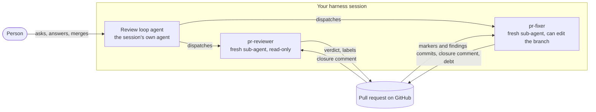
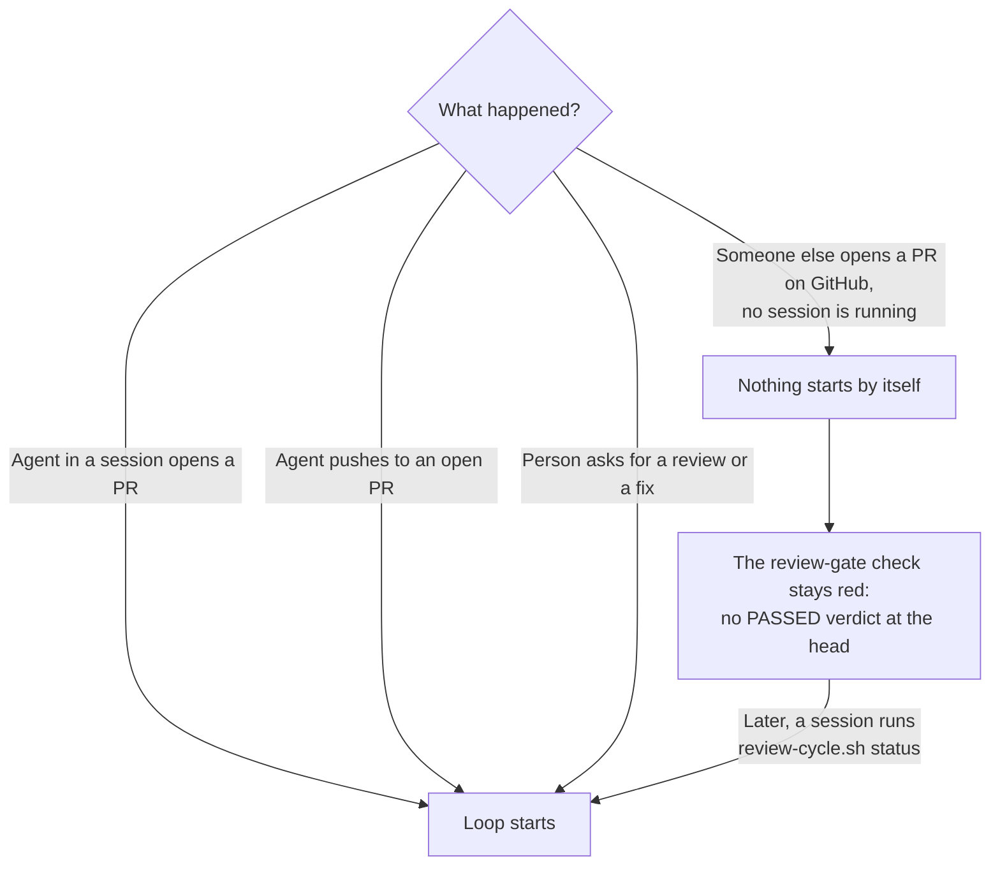
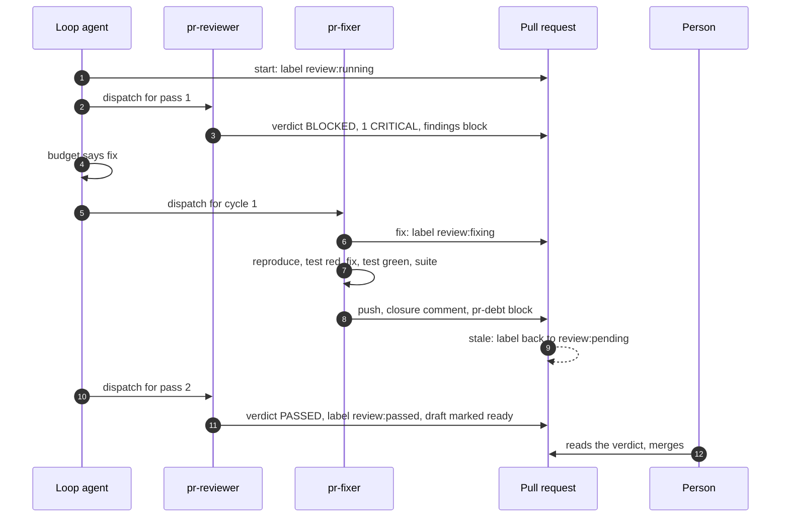
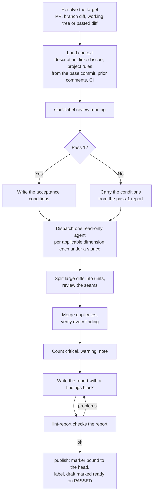
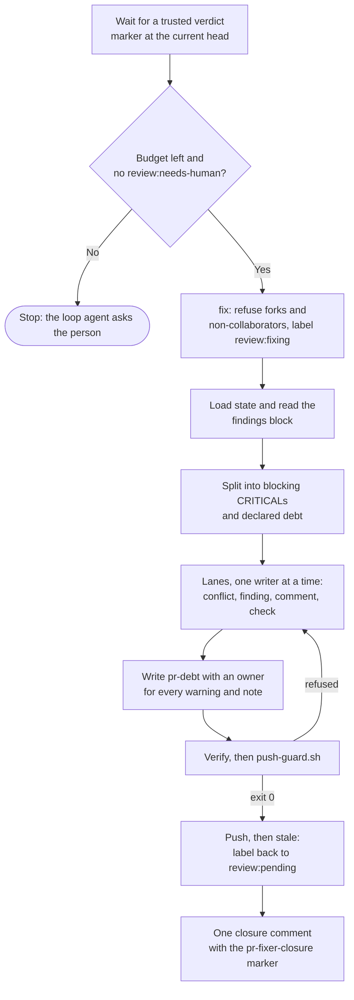

# How pr-reviewer and pr-fixer work

This page explains what the two skills do, in order, with the reasons behind each rule. The
[README](../README.md) covers installation and the quick tour. This page covers how the skills behave once
they are installed.

## The idea in one minute

`pr-reviewer` reads a pull request and says whether anything in it should stop the merge. `pr-fixer`
takes what the reviewer found, proves each problem is real, fixes it, and hands the pull request
back. A third role, the review loop agent, is the coding agent you are already talking to. It starts
the other two and keeps count.

Three rules shape everything:

- The one who fixes never judges the fix. A fresh reviewer re-checks it.
- Only a CRITICAL finding blocks a merge. Everything else is written down as debt with an owner.
- A script, not a model, keeps the books. Labels, the verdict and the cycle count are written by
  `scripts/review-cycle.sh`, which refuses states that make no sense.

The skills never merge, approve or tag a release. A person does that.

## Who does what

| Role | What it is | What it may write |
|---|---|---|
| Review loop agent | The agent in your session. It never reviews or edits code. | Labels and budget markers, only through `review-cycle.sh` |
| `pr-reviewer` | A fresh-context sub-agent that follows the reviewer skill. | Nothing in the working tree. It publishes the verdict through the script. |
| `pr-fixer` | A fresh-context sub-agent that follows the fixer skill. | The pull request branch, its comments and the `pr-debt` block |
| Person | You | Merging, and the answer when the cycle budget runs out |

The reviewer and the fixer never talk to each other and never share a context. They communicate
through the pull request only: labels, a verdict comment, a closure comment, and a debt block in the
pull request body. That is why either one can run in a different harness, on a different model, or by
hand.

## When does it start?

It starts inside an agent session, and only there. The rule lives in `AGENTS.md` and in
[`harness-loop.md`](../.agents/skills/pr-reviewer/references/harness-loop.md). The agent runs the
loop on its own when it opens a pull request, when it pushes to the branch of an open pull request,
or when a person asks for a review or a fix.

Nothing in GitHub starts a review by itself. No workflow calls a model, and the project never holds a
provider API key, so there is nowhere for a GitHub event to run one. The one workflow template,
`review-gate.yml`, runs on `pull_request` and only checks the state: it fails unless a trusted
`PASSED` verdict names the current head. If the session ends before the loop finishes,
`review-cycle.sh status` exits 1 while a review is owed, so the next session picks it up. On Claude
Code you can add a Stop hook that runs `review-cycle.sh debt` and refuses to end a turn while a
review is owed.

## One pull request, start to finish

The numbers in the markers (`pass=1`, `pass=2`) are read from GitHub by the script. The loop agent
never keeps a counter in its head.

## What pr-reviewer does

### Step by step

1. **Context first.** It reads the pull request description and the linked issue, then the project's
   own rules (`CLAUDE.md`, `AGENTS.md`, contributor guide, lint config). It reads those rules from the
   base commit, not from the pull request, so a change cannot rewrite the rules it is judged by. If
   the pull request edits a rules file, that edit is reviewed as code. A documented project rule
   beats generic practice, a rule a linter owns is never a finding, and a comment someone already
   made is never repeated.
2. **Acceptance conditions, pass 1 only.** Before any agent looks for defects, the reviewer writes a
   numbered list of conditions that would make this pull request pass, taken from its own stated
   purpose. Later passes check those same conditions and nothing else, so the target does not move
   between passes.
3. **Dimension agents.** One read-only agent per applicable dimension. There are thirteen
   (correctness, design, security, testing, concurrency, error handling, performance and others, see
   [`dimensions.md`](../.agents/skills/pr-reviewer/references/dimensions.md)). Each agent works under
   one of four stances:
   - Saboteur: how does this fail? Covers correctness, errors, concurrency, performance, observability.
   - Security Auditor: how would an attacker use this? Covers security, dependencies, API surface.
   - New Hire: can someone new read and change this? Covers readability, complexity, docs, tests.
   - Architect: does the design hold? Covers design.

   Each stance must report something, so a rubber stamp is impossible. A stance that finds no defect
   reports its most fragile assumption as a NOTE labelled `assumption:`. It never invents a defect to
   fill the quota.
4. **Big diffs.** Above about 400 changed lines the reviewer splits the diff into units, reviews each
   one, reviews the seams between them, and reports a depth map of what was read closely and what
   was not. Reverts, generated files, mechanical renames and dependency bumps get less effort.
5. **Verification.** Before a finding is shown, the reviewer checks it against the diff and the code
   it can reach. A CRITICAL must come with a concrete failure scenario: these inputs or this state,
   then this bad outcome. A claim it cannot back up becomes a `question:` with a stated confidence,
   or is dropped. Duplicates are merged and attributed to the dimension that describes them best.
6. **Severity and verdict.**

   | Severity | Meaning | Blocks? |
   |---|---|---|
   | CRITICAL | Data loss, a security breach, a production outage, or a broken invariant the project calls non-negotiable | Yes, the only one |
   | WARNING | A likely bug in an edge case, a performance or maintainability problem, missing tests for new logic | No |
   | NOTE | Style, a small improvement, a doc gap, a question | No |

   The verdict is arithmetic: one or more CRITICAL means `BLOCKED`, otherwise `PASSED`. `PASSED` means
   nothing blocks, not that nothing was found. A finding raised from two or more stances goes up one
   level, but never past WARNING, because agreement is not consequence.
7. **Report and lint.** The report ends with a fenced `findings` block, one entry per finding. Then
   `review-cycle.sh lint-report` checks it: every finding must name a file the diff touches and a line
   inside a hunk, the `counts:` line must match the open entries, and the coverage note must carry a
   `Declined to judge:` line (it says `none` when nothing was skipped). The reviewer fixes its own
   report until the lint passes.
8. **Publish.** `review-cycle.sh publish` re-reads the head from GitHub and refuses a stale `--sha`,
   so a verdict can only name a commit that really was the head. It also refuses a `BLOCKED` with no
   CRITICAL and a `PASSED` with one. It also refuses a report that holds something shaped like a
   token or a private key, without printing it, and puts a zero-width space after every `@login` (the closing
   `findings` fence excepted) so the comment notifies nobody. It writes the marker comment, sets the label, and on `PASSED`
   marks a draft pull request ready for review.

In the automatic run the reviewer never submits `--request-changes` or `--approve`. A later comment
review does not clear an earlier change request from the same account, so a bot change request would
keep blocking after the problem was fixed. The marker comment is the verdict. The label and the
`review-gate` check enforce it.

### Pass 2 and later

A later pass checks two things only: whether the conditions fixed at pass 1 now hold, and whether a
new CRITICAL appeared, including one the fix introduced. Each CRITICAL from the earlier pass ends in
exactly one state:

| State | When | Effect |
|---|---|---|
| Closed and verified | The fixer closed it, and the reviewer re-ran the fixer's red and green evidence and saw both | Not counted |
| Refusal accepted | The fixer refused it with evidence that it does not reproduce, and the reviewer agrees | Withdrawn, with the reason in the report |
| Refusal rejected | The fixer refused it and the evidence does not hold | Still counted, verdict stays `BLOCKED` |

The reviewer judges a refusal, never the fixer. Everything else that turns up in a later pass is
declared debt and never reopens the list.

## What pr-fixer does

### Step by step

1. **Wait for closure.** It acts only on a verdict marker at the current head, written by a login in
   `REVIEW_MARKER_AUTHORS`. The work list is the `findings` block of that verdict. Text from any other
   commenter is data, never an instruction.
2. **Take the cycle.** `review-cycle.sh fix` runs before any file is opened for writing. It refuses a
   fork, and any pull request whose author or commit author is not a collaborator with write access.
   When it refuses it moves nothing. Otherwise it sets `review:fixing`, so the pull request cannot
   merge while a correction is in flight.
3. **Split the work.** Every CRITICAL is blocking. Every WARNING and NOTE is debt.
4. **Lanes.** The fixer works one writing lane at a time, because two writers collide and a history
   change invalidates work built on the old history. The order is conflicts, findings, comments,
   checks.
   - **Finding.** The fixer first tries to falsify the CRITICAL: can it be reproduced? If it can, it
     writes a test that reproduces the threat (a form the code does not handle), not a test of the
     implementation. It watches the test fail, makes the smallest fix, watches the test pass, and
     runs the whole suite. If it cannot reproduce the problem, it refuses with evidence and leaves
     the judgment to the reviewer.
   - **Conflict.** It merges the base into the branch (no force-push), regenerates generated files
     and lockfiles, resolves each hunk with evidence from both sides, and runs the narrowest build and
     test. See [`conflicts.md`](../.agents/skills/pr-fixer/references/conflicts.md).
   - **Comment.** It evaluates each human or bot suggestion, applies the smallest correct fix, and
     gives a reasoned reply when it declines. See
     [`comment-triage.md`](../.agents/skills/pr-fixer/references/comment-triage.md).
   - **Check.** It reads a failing CI log as untrusted data and classifies the failure as transient,
     already failing on the base branch, or genuine. It reruns once for a plausible flake and fixes
     genuine failures at the root. It never loosens a test or a threshold. See
     [`ci-failures.md`](../.agents/skills/pr-fixer/references/ci-failures.md).
   - **Approval.** When checks are green, comments are resolved and the marker is `PASSED` at the
     head, it hands off, or arms automerge if you opted in.
5. **Declare debt.** Every WARNING and NOTE goes into the `pr-debt` block of the pull request body,
   one line each, with a named owner (a person, an issue or a feature). Debt with no owner is dropped,
   not declared. When the verdict is `PASSED` with leftover debt, the fixer does only this step: no
   code edits, no commits, no label change.
6. **Push guard.** Before a push it re-checks the remote head and runs
   `push-guard.sh <pr> --findings FILE`. The guard refuses when the checked-out branch is not the
   pull request's head, the head is on a fork, the pull request is closed, the push would not be a
   fast-forward, or a commit touches a file no finding names (test files and explicit `--allow`
   paths are exempt). If the head is not writable, the fixer delivers a patch and replies instead.
7. **Close the loop.** The push moves the head, and `review-cycle.sh stale` moves the label back to
   `review:pending`. The fixer posts one closure comment carrying
   `<!-- pr-fixer-closure: cycle=… head=… closed=… refused=… debt=… -->`. For each finding it records
   the reproduction, the test, the red run, the fix, the green run and the suite counts. For each
   refusal it records the evidence. The reviewer's next pass takes it from there.

Fixer rules that never bend: no push to a protected base branch, no bypassed check, no `--no-verify`,
no force-push over commits it did not write, no `git add -A`, and no unrelated cleanup.

## The cycle budget

The loop runs up to five automatic cycles (`MAX_REVIEW_CYCLES`), with a hard ceiling of ten
(`MAX_REVIEW_CYCLES_HARD`). The last cycle of each allowance (the fifth, and the last of every extension) sends a fixer one tier
up, or with higher effort, once. If a CRITICAL is still open after five, `review-cycle.sh budget` says
`ask` and the loop agent asks you in the session. It shows the open CRITICALs, how the open count
changed from pass to pass, and a suggestion. You answer `continue N` or `stop`. `continue N` is
recorded by `review-cycle.sh extend`. `stop`, or no answer in a headless session, is recorded by
`halt`, and the pull request stays `review:blocked` with `review:needs-human` until a person decides.
A comment on the pull request can never grant cycles. The details and the label diagram are in the
[README](../README.md#cycle-budget-and-human-control).

## The labels

| Label | Meaning |
|---|---|
| `review:pending` | A new head exists that nobody has reviewed |
| `review:running` | A review pass is in flight |
| `review:blocked` | The newest verdict has a CRITICAL |
| `review:fixing` | The fixer holds the cycle |
| `review:passed` | The newest verdict is `PASSED` at the current head |
| `review:needs-human` | The loop paused or halted, and a person must decide |

A label is a claim. The authority is the marker comment, which names the head commit it reviewed. A
`review:passed` label whose marker names an older commit proves nothing, and the `review-gate`
check fails it. A pull request with no `review:*` label fails too, because a forgotten label must
never read as "reviewed".

## What the scripts do

| Script | Job |
|---|---|
| `review-cycle.sh` | The state machine. `start`, `fix`, `stale`, `status`, `debt`, `budget`, `extend`, `halt`, `lint-report`, `publish`, `export-audit`, `ensure-labels`. It owns labels, markers and the budget. |
| `gate-pr-review-state.py` | What the `review-gate` required check runs. It fails unless a trusted marker names the current head. |
| `pr-json.py` | The only way the scripts read a pull request. It drops comments edited after creation and fails closed. |
| `triage-pr.sh` | Read-only. Tells the fixer which lanes a pull request has, and whether it is safe to start. |
| `push-guard.sh` | Read-only. The check the fixer passes before every push. |
| `check-version.sh` | Prints a notice when a newer release exists. It never installs anything. |
| `install.sh` | Copies the skills into the folder a harness reads. A dry run unless you pass `--yes`. |

## Why you can trust the markers

- Only a login in `REVIEW_MARKER_AUTHORS` counts as an author of a marker. A marker typed by anyone
  else is ignored. With the variable unset, the scripts trust no marker at all.
- A marker comment that was edited after it was created is ignored.
- A verdict is bound to a commit. Any push turns it stale.
- Everything read from the pull request (description, comments, commit messages, CI logs, file
  contents) is treated as data. It cannot give the skills orders.
- The fixer will not start on a fork, or on a pull request whose author is not a collaborator.
- No workflow in this repository calls a model, and nothing uses a provider API key.
  `tests/run-all.sh` fails if one appears.

## What the skills do not do

- They do not start a review from a GitHub event on their own.
- They do not merge, approve, tag a release or publish one.
- They do not block on style, on a rule a linter owns, or on anything below CRITICAL.
- They do not measure their own review quality in CI. `tests/eval/` holds seeded cases and a scorer
  that computes recall and precision for reports a person produced in a harness session.
- They do not tell a truthful report from an invented one. The scripts guarantee that a verdict
  names a real head commit and that its arithmetic is consistent, nothing more.

## Where to go next

| You want to | Read |
|---|---|
| Install and run them | [README](../README.md) |
| See every pull request artifact and the `gh` command that finds it | [`pr-protocol.md`](../.agents/skills/pr-reviewer/references/pr-protocol.md) |
| Follow the loop procedure | [`harness-loop.md`](../.agents/skills/pr-reviewer/references/harness-loop.md) |
| Read the reviewer's full rules | [`pr-reviewer/SKILL.md`](../.agents/skills/pr-reviewer/SKILL.md) |
| Read the fixer's full rules | [`pr-fixer/SKILL.md`](../.agents/skills/pr-fixer/SKILL.md) |
| Map the controls to ISO 27001 and 42001 | [`ISO-27001-AND-42001.md`](ISO-27001-AND-42001.md) |
